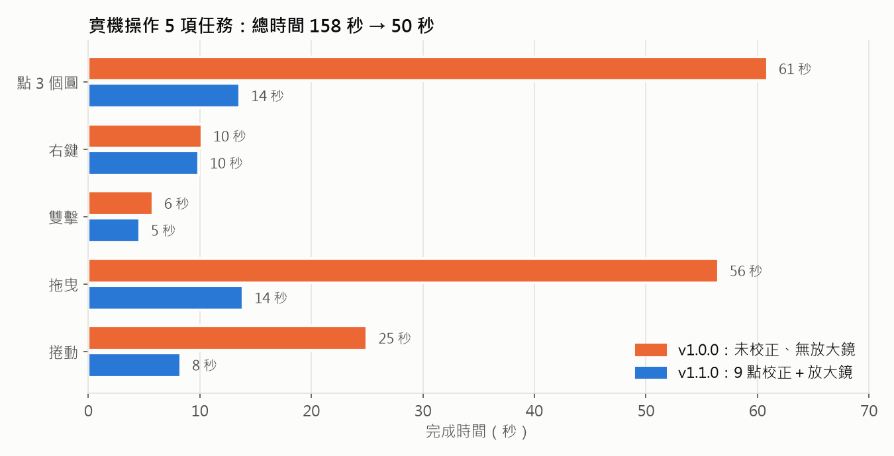

# 眼動鼠 EyeMouse

用眼睛（或頭部）取代滑鼠：**看哪裡，游標就到哪裡；盯著不動就點擊**。
為「眼睛正常、但無法說話與自主行動」的臥床者設計，延續病房團隊「Eye 讓生活改變」的創意。

## 功能
- 放大鏡精準點擊：第一次停留先放大那一區，再盯著要點的位置（小按鈕也點得準）
- 停留點擊：左鍵點一下、連按兩下、右鍵、**拖曳（停留按住 → 移動 → 停留放開）**、捲動（往上／下看）
- 螢幕右側大按鈕工具列（看著按鈕停留即切換），暫停／繼續、螢幕鍵盤（Windows 觸控鍵盤，有注音、按鍵大）
- 可愛的眼動鼠游標：中心透明的旋轉光環＋會跟著視線轉眼睛的小老鼠，停留時光環變進度條
- 照顧者動實體滑鼠時自動讓手；Ctrl+Alt+P 暫停、Ctrl+Alt+M 叫出控制面板
- 9 點校正（小老鼠帶著看）
- 繁體中文語音提示＋10 頁動畫教學（含互動練習）
- 眼動評估：素材時間軸 → 全螢幕錄製 → 注視軌跡（編號順序）、熱點圖、興趣區 AOI 統計、回放，匯出 MP4／CSV／PNG
- 自動檢查更新（GitHub Releases）

## 實機測量（Tobii Eye Tracker 5）

校正＋放大鏡後，5 項操作任務總時間 **158 秒 → 50 秒**，點擊落點誤差 **50～80 px → 9～14 px**。
完整數據與說明見 [docs/measurements](docs/measurements/README.md)。



## 平台
| 平台 | 視線來源 |
|---|---|
| Windows 10/11 | Tobii Eye Tracker 5（Tobii Stream Engine）眼球或頭控；或攝影機。**需先安裝 Tobii 驅動與 Tobii Experience，並完成螢幕設定與校正**，見 [Tobii 安裝與設定](docs/tobii-setup.md) |
| macOS | Tobii 5 官方不支援 Mac → 內建攝影機（MediaPipe 臉部＋虹膜），建議「頭部控制」 |

## 開發
```
pip install -r requirements.txt
python eyemouse.py            # 執行
python eyemouse.py --selftest # 自我測試
python tests/test_controller.py
python tools/gen_voice.py     # 重新產生語音（edge-tts 曉臻）
bash tools/build_win.sh       # Windows 安裝檔 → dist-installer/EyeMouse-Setup.exe
bash tools/build_mac.sh       # Mac → dist-installer/EyeMouse-macOS.dmg
```
版本號只改 `VERSION`。設定存在 `%LOCALAPPDATA%\EyeMouse`（Mac：`~/Library/Application Support/EyeMouse`）。

系統開發：吳玉柱 先生 與 Claude AI Opus 5.5
