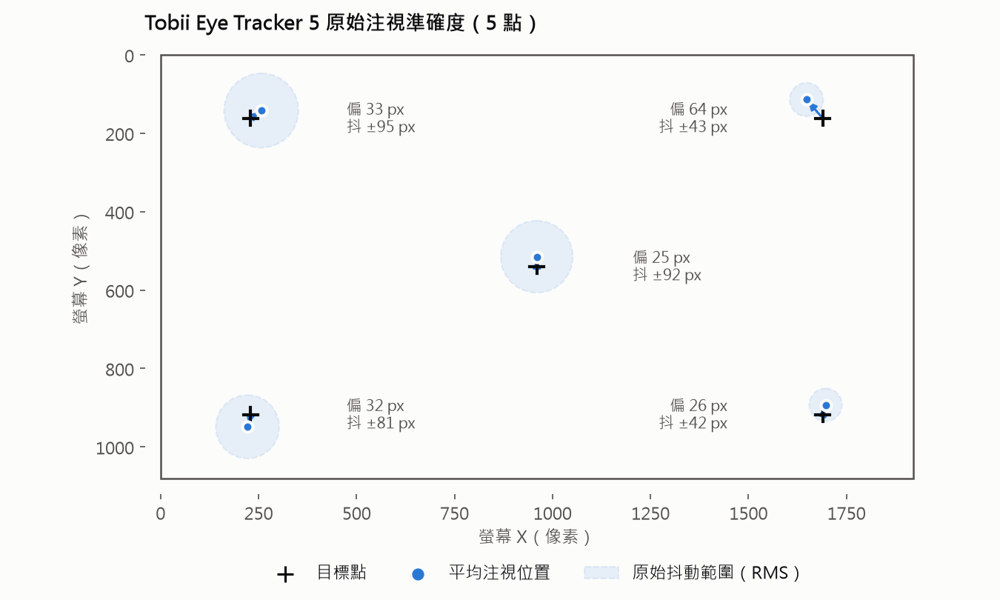
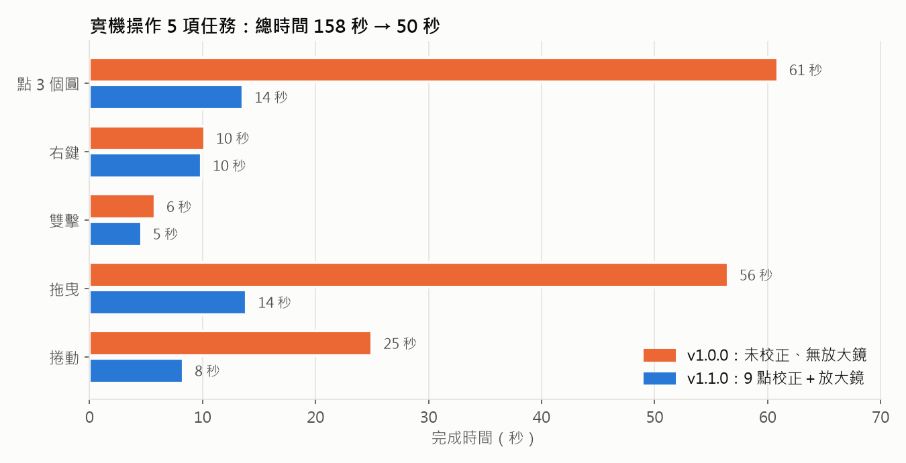
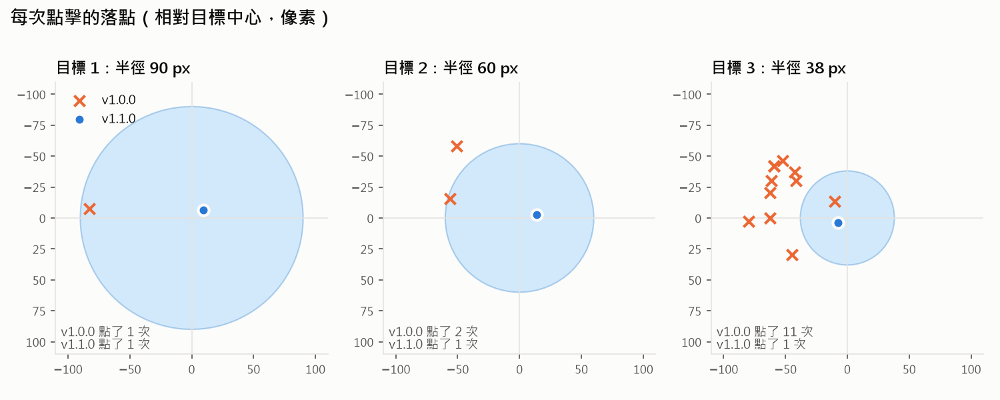

# 眼動鼠實機測量報告（Tobii Eye Tracker 5）

測試日期：2026-11-14
測試者：開發者本人（非臥床使用者；臨床使用前仍應由使用者實測）

## 測試環境

| 項目 | 內容 |
|---|---|
| 眼動儀 | Tobii Eye Tracker 5（USB，Tobii Experience 已完成螢幕設定與校正） |
| SDK | Tobii Stream Engine 4.25.0（Tobii 驅動附帶的 `tobii_stream_engine.dll`） |
| 電腦 | Windows 11 筆電，15.6 吋 1920×1080（實體 344×194 mm） |
| 坐姿 | 眼睛距眼動儀約 45～62 cm |
| 注視資料 | 約每秒 33 筆（Stream Engine 消費版的互動用途串流） |

## 1. 原始注視準確度

全螢幕依序顯示 5 個紅點，每點 3 秒，取第 1.2～3.0 秒的原始注視點（**未經眼動鼠校正、未濾波**）。

| 點 | 平均偏移 | 抖動（RMS） |
|---|---|---|
| 中央 | 25 px | ±92 px |
| 左上 | 33 px | ±95 px |
| 右上 | 64 px | ±43 px |
| 右下 | 26 px | ±42 px |
| 左下 | 32 px | ±81 px |

- **偏移**（平均位置離目標多遠）25～64 px，約 0.5～1.2 cm，以眼動儀來說屬正常水準，而且方向相當固定，可以靠校正修正。
- **抖動**（每一筆注視點跳動的範圍）較大，最多到 ±95 px。眼動鼠用 One Euro 濾波和「停留範圍內取平均」來抵銷抖動。
- 再用眼動鼠內建的 9 點校正，在 Tobii 的結果上做一次仿射修正：每點收到 37～38 筆，校正後誤差中位數 **19 px**。

## 2. 實機操作 5 項任務

操作全部用眼睛完成，由眼動鼠送出真正的滑鼠事件，測驗程式記錄每一次按下的位置：

1. 依序點 3 個越來越小的圓（半徑 90／60／38 px）
2. 工具列選「右鍵」，右鍵點橘色方塊
3. 工具列選「雙擊」，雙擊紫色方塊
4. 工具列選「拖曳」，把綠球拖進籃子
5. 工具列選「捲動」，把清單捲到底

| 任務 | v1.0.0（未校正、無放大鏡） | v1.1.0（9 點校正＋放大鏡） |
|---|---|---|
| 點 3 個圓 | 61 秒，按了 14 次 | **14 秒，3 次全中** |
| 右鍵 | 10 秒 | 10 秒 |
| 雙擊 | 6 秒 | 5 秒 |
| 拖曳 | 56 秒（反覆偏離綠球） | **14 秒，一次放進籃子** |
| 捲動 | 25 秒 | **8 秒** |
| **合計** | **158 秒** | **50 秒** |

## 3. 每次點擊的落點

以目標中心為原點，畫出每一次左鍵按下的位置（× 是 v1.0.0，● 是 v1.1.0）：

- **v1.0.0**：落點一致偏向左上方約 50～80 px。最小的目標（半徑 38 px）按了 11 次才命中。
- **v1.1.0**：3 個目標的落點都在 **9～14 px** 以內，每個都一次命中。

## 結論與 v1.1.0 的改進

1. **9 點校正**：修正 Tobii 固定方向的偏移。
2. **放大鏡精準點擊**（預設開啟）：第一次停留先把那一區放大 2.5 倍，再盯著放大畫面裡要點的位置停留一次；看放大鏡外面就是取消。對 Windows 標題列的關閉鈕這類小目標特別有幫助。
3. **斷線自動重連**：測試中 USB 曾經兩次中斷，眼動鼠在眼動儀接回後自動恢復，校正資料也沿用。

## 原始資料與重現

- `accuracy.json`：5 點準確度
- `handson_before.json`、`handson_after.json`：兩次操作測驗的全部滑鼠事件（時間、位置、任務）
- 重新產生圖表：`python tools/make_charts.py`

> Tobii 消費級眼動儀的授權只限「即時互動」用途；錄存視線做分析（包括本報告與眼動評估功能）在正式臨床使用前，請先向 Tobii 或代理商確認授權。
